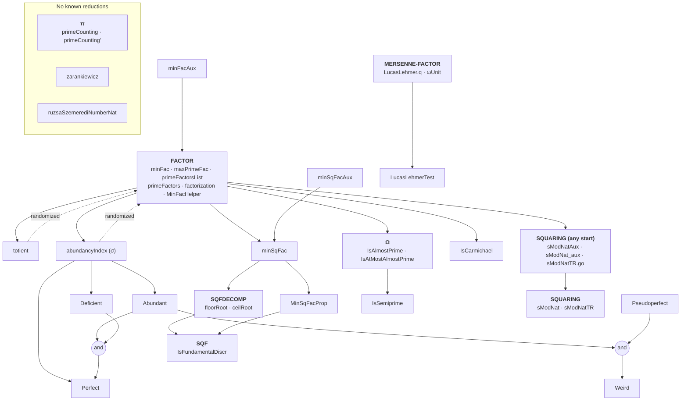

# Implications among the open-status countable-I/O functions

These are the Mathlib functions with countable inputs and outputs whose polynomial-time status is open (inputs in binary).

## Diagram

Each node is a class of polynomial-time-equivalent functions. A → B means: if A is polytime, so is B.
Dashed arrows are randomized reductions only. An "and" node means both sources are needed.
Arrows implied by chaining are omitted.

## Full matrix

Row R, column C is marked when R polytime ⇒ C polytime.
X means a deterministic reduction; r means randomized only (Miller; Bach–Miller–Shallit).

| # | If this is polytime… ⟶ | 1 | 2 | 3 | 4 | 5 | 6 | 7 | 8 | 9 | 10 | 11 | 12 | 13 | 14 | 15 | 16 | 17 | 18 | 19 | 20 | 21 | 22 | 23 | 24 | 25 | 26 | 27 | 28 | 29 | 30 | 31 | 32 | 33 | 34 | 35 | 36 |
|---|---|---|---|---|---|---|---|---|---|---|---|---|---|---|---|---|---|---|---|---|---|---|---|---|---|---|---|---|---|---|---|---|---|---|---|---|---|
| 1 | `minFac` | X | X | X | X | X | X |  | X | X | X | X | X |  |  |  | X | X | X | X | X | X | X | X | X | X | X | X | X | X |  |  |  |  |  |  |  |
| 2 | `maxPrimeFac` | X | X | X | X | X | X |  | X | X | X | X | X |  |  |  | X | X | X | X | X | X | X | X | X | X | X | X | X | X |  |  |  |  |  |  |  |
| 3 | `primeFactorsList` | X | X | X | X | X | X |  | X | X | X | X | X |  |  |  | X | X | X | X | X | X | X | X | X | X | X | X | X | X |  |  |  |  |  |  |  |
| 4 | `primeFactors` | X | X | X | X | X | X |  | X | X | X | X | X |  |  |  | X | X | X | X | X | X | X | X | X | X | X | X | X | X |  |  |  |  |  |  |  |
| 5 | `factorization` | X | X | X | X | X | X |  | X | X | X | X | X |  |  |  | X | X | X | X | X | X | X | X | X | X | X | X | X | X |  |  |  |  |  |  |  |
| 6 | `MinFacHelper` | X | X | X | X | X | X |  | X | X | X | X | X |  |  |  | X | X | X | X | X | X | X | X | X | X | X | X | X | X |  |  |  |  |  |  |  |
| 7 | `minFacAux` | X | X | X | X | X | X | X | X | X | X | X | X |  |  |  | X | X | X | X | X | X | X | X | X | X | X | X | X | X |  |  |  |  |  |  |  |
| 8 | `totient` | r | r | r | r | r | r |  | X | r | r | r | r |  |  |  | r | r | r | r | r | r | r | r | r | r | r | r | r | r |  |  |  |  |  |  |  |
| 9 | `abundancyIndex` | r | r | r | r | r | r |  | r | X | X | X | X |  |  |  | r | r | r | r | r | r | r | r | r | r | r | r | r | r |  |  |  |  |  |  |  |
| 10 | `Abundant` |  |  |  |  |  |  |  |  |  | X |  |  |  |  |  |  |  |  |  |  |  |  |  |  |  |  |  |  |  |  |  |  |  |  |  |  |
| 11 | `Deficient` |  |  |  |  |  |  |  |  |  |  | X |  |  |  |  |  |  |  |  |  |  |  |  |  |  |  |  |  |  |  |  |  |  |  |  |  |
| 12 | `Perfect` |  |  |  |  |  |  |  |  |  |  |  | X |  |  |  |  |  |  |  |  |  |  |  |  |  |  |  |  |  |  |  |  |  |  |  |  |
| 13 | `Pseudoperfect` |  |  |  |  |  |  |  |  |  |  |  |  | X |  |  |  |  |  |  |  |  |  |  |  |  |  |  |  |  |  |  |  |  |  |  |  |
| 14 | `Weird` |  |  |  |  |  |  |  |  |  |  |  |  |  | X |  |  |  |  |  |  |  |  |  |  |  |  |  |  |  |  |  |  |  |  |  |  |
| 15 | `minSqFacAux` |  |  |  |  |  |  |  |  |  |  |  |  |  |  | X | X | X | X | X | X |  |  |  |  |  |  |  |  |  |  |  |  |  |  |  |  |
| 16 | `minSqFac` |  |  |  |  |  |  |  |  |  |  |  |  |  |  |  | X | X | X | X | X |  |  |  |  |  |  |  |  |  |  |  |  |  |  |  |  |
| 17 | `MinSqFacProp` |  |  |  |  |  |  |  |  |  |  |  |  |  |  |  |  | X |  |  | X |  |  |  |  |  |  |  |  |  |  |  |  |  |  |  |  |
| 18 | `floorRoot` |  |  |  |  |  |  |  |  |  |  |  |  |  |  |  |  |  | X | X | X |  |  |  |  |  |  |  |  |  |  |  |  |  |  |  |  |
| 19 | `ceilRoot` |  |  |  |  |  |  |  |  |  |  |  |  |  |  |  |  |  | X | X | X |  |  |  |  |  |  |  |  |  |  |  |  |  |  |  |  |
| 20 | `IsFundamentalDiscr` |  |  |  |  |  |  |  |  |  |  |  |  |  |  |  |  |  |  |  | X |  |  |  |  |  |  |  |  |  |  |  |  |  |  |  |  |
| 21 | `IsAlmostPrime` |  |  |  |  |  |  |  |  |  |  |  |  |  |  |  |  |  |  |  |  | X | X | X |  |  |  |  |  |  |  |  |  |  |  |  |  |
| 22 | `IsAtMostAlmostPrime` |  |  |  |  |  |  |  |  |  |  |  |  |  |  |  |  |  |  |  |  | X | X | X |  |  |  |  |  |  |  |  |  |  |  |  |  |
| 23 | `IsSemiprime` |  |  |  |  |  |  |  |  |  |  |  |  |  |  |  |  |  |  |  |  |  |  | X |  |  |  |  |  |  |  |  |  |  |  |  |  |
| 24 | `IsCarmichael` |  |  |  |  |  |  |  |  |  |  |  |  |  |  |  |  |  |  |  |  |  |  |  | X |  |  |  |  |  |  |  |  |  |  |  |  |
| 25 | `sModNatAux` |  |  |  |  |  |  |  |  |  |  |  |  |  |  |  |  |  |  |  |  |  |  |  |  | X | X | X | X | X |  |  |  |  |  |  |  |
| 26 | `sModNat_aux` |  |  |  |  |  |  |  |  |  |  |  |  |  |  |  |  |  |  |  |  |  |  |  |  | X | X | X | X | X |  |  |  |  |  |  |  |
| 27 | `sModNatTR.go` |  |  |  |  |  |  |  |  |  |  |  |  |  |  |  |  |  |  |  |  |  |  |  |  | X | X | X | X | X |  |  |  |  |  |  |  |
| 28 | `sModNat` |  |  |  |  |  |  |  |  |  |  |  |  |  |  |  |  |  |  |  |  |  |  |  |  |  |  |  | X | X |  |  |  |  |  |  |  |
| 29 | `sModNatTR` |  |  |  |  |  |  |  |  |  |  |  |  |  |  |  |  |  |  |  |  |  |  |  |  |  |  |  | X | X |  |  |  |  |  |  |  |
| 30 | `q` |  |  |  |  |  |  |  |  |  |  |  |  |  |  |  |  |  |  |  |  |  |  |  |  |  |  |  |  |  | X | X | X |  |  |  |  |
| 31 | `ωUnit` |  |  |  |  |  |  |  |  |  |  |  |  |  |  |  |  |  |  |  |  |  |  |  |  |  |  |  |  |  | X | X | X |  |  |  |  |
| 32 | `LucasLehmerTest` |  |  |  |  |  |  |  |  |  |  |  |  |  |  |  |  |  |  |  |  |  |  |  |  |  |  |  |  |  |  |  | X |  |  |  |  |
| 33 | `primeCounting` |  |  |  |  |  |  |  |  |  |  |  |  |  |  |  |  |  |  |  |  |  |  |  |  |  |  |  |  |  |  |  |  | X | X |  |  |
| 34 | `primeCounting'` |  |  |  |  |  |  |  |  |  |  |  |  |  |  |  |  |  |  |  |  |  |  |  |  |  |  |  |  |  |  |  |  | X | X |  |  |
| 35 | `zarankiewicz` |  |  |  |  |  |  |  |  |  |  |  |  |  |  |  |  |  |  |  |  |  |  |  |  |  |  |  |  |  |  |  |  |  |  | X |  |
| 36 | `ruzsaSzemerediNumberNat` |  |  |  |  |  |  |  |  |  |  |  |  |  |  |  |  |  |  |  |  |  |  |  |  |  |  |  |  |  |  |  |  |  |  |  | X |

Columns: 1 = `minFac`, 2 = `maxPrimeFac`, 3 = `primeFactorsList`, 4 = `primeFactors`, 5 = `factorization`, 6 = `MinFacHelper`, 7 = `minFacAux`, 8 = `totient`, 9 = `abundancyIndex`, 10 = `Abundant`, 11 = `Deficient`, 12 = `Perfect`, 13 = `Pseudoperfect`, 14 = `Weird`, 15 = `minSqFacAux`, 16 = `minSqFac`, 17 = `MinSqFacProp`, 18 = `floorRoot`, 19 = `ceilRoot`, 20 = `IsFundamentalDiscr`, 21 = `IsAlmostPrime`, 22 = `IsAtMostAlmostPrime`, 23 = `IsSemiprime`, 24 = `IsCarmichael`, 25 = `sModNatAux`, 26 = `sModNat_aux`, 27 = `sModNatTR.go`, 28 = `sModNat`, 29 = `sModNatTR`, 30 = `q`, 31 = `ωUnit`, 32 = `LucasLehmerTest`, 33 = `primeCounting`, 34 = `primeCounting'`, 35 = `zarankiewicz`, 36 = `ruzsaSzemerediNumberNat`
